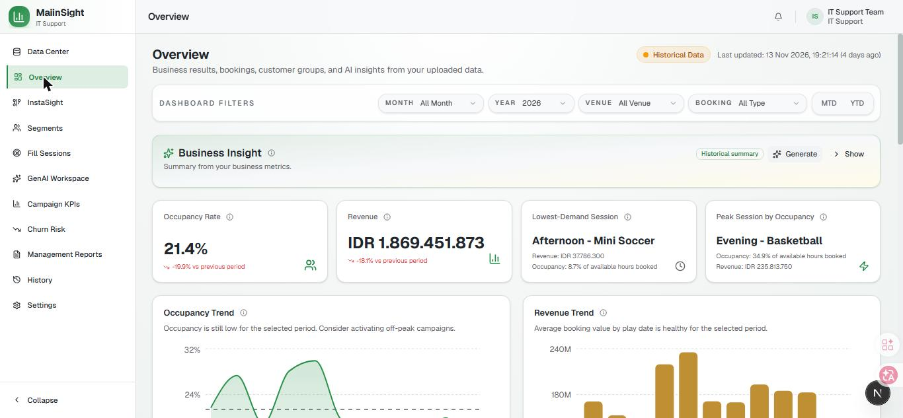
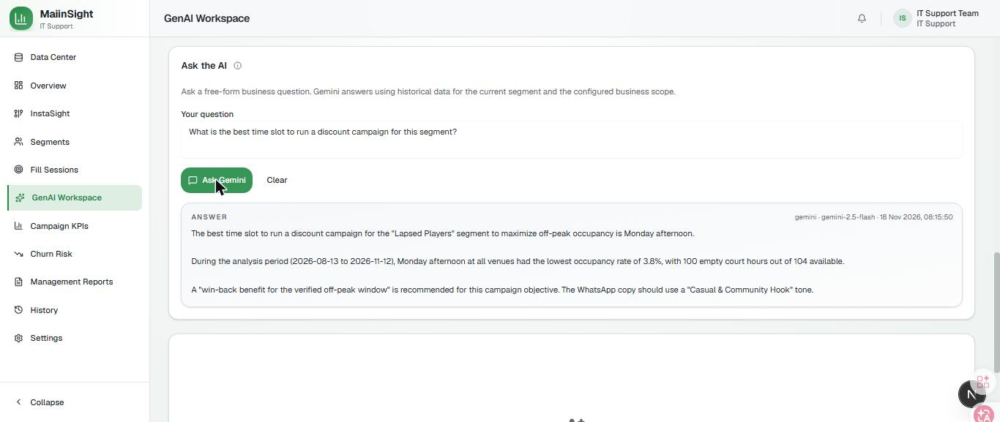

# 🏟️ MaiinSight — Frontend

> **What if a sports venue's booking history could tell you exactly who's about to stop coming back — before they do, and what to say to bring them back?**

Next.js · TypeScript · K-Means++ Segmentation · Logistic Regression Churn Model · Two-Proportion Z-Test · Holt's Forecasting · Gemini AI


[Overview](#-overview) · [Data Science Highlights](#-data-science--ai-highlights) · [Features](#-core-modules) · [Tech Stack](#-tech-stack) · [Getting Started](#-getting-started) · [Architecture](#-project-structure) · [Limitations](#-honest-limitations) · [Backend repo](https://github.com/greythinkerdue/maiinsight-backend)

---


*Business snapshot — occupancy, revenue, and an AI-generated business insight, built from the uploaded booking data.*


*Free-form business question answered by Gemini, grounded in the venue's actual occupancy data — not a canned response.*

## ✨ Overview

**MaiinSight** is a marketing decision-support dashboard built for **Maiin Gandaria**, a multi-court sports venue business (basketball, mini soccer). Instead of guessing which customers to target or which time slots need a push, MaiinSight turns raw booking history into a segmentation model, a churn-risk predictor, a demand forecast, and an AI strategy assistant — then ties all of it directly into real outreach campaigns with proper experiment design (holdout groups, significance testing, consent gates).

This repo is the **frontend** — a Next.js dashboard consumed by three roles (Operational, Management, IT Support), each with a different scope of what they can see and do.

> Backend (API, database, ML services) lives in a companion repo: **[maiinsight-backend](https://github.com/greythinkerdue/maiinsight-backend)**.

## 🧠 Data Science & AI Highlights

The dashboard isn't just charts — every number on it is backed by a model built from scratch (no `scikit-learn`, no stats library), with the honest caveats surfaced in the UI itself:

- **Customer segmentation (unsupervised ML).** K-Means++ with a seeded PRNG for reproducible clustering, RFM feature engineering with log-transform + winsorization, and Silhouette/Elbow-method validation — 4 business-ready segments (High-Value, Regular, Occasional, Lapsed).
- **Churn / reactivation-risk prediction (supervised ML).** A logistic regression trained on leakage-safe, time-split historical snapshots predicts which currently-active customers are about to stop booking — with per-customer explainability (which factors drove the score) and a direct "send reactivation campaign" action.
- **Statistical significance testing.** Campaign lift ("treatment converted 15% more than holdout") is backed by a two-proportion z-test and a Wald confidence interval — with a minimum-sample-size guard that withholds the result entirely rather than report a misleading one.
- **Demand forecasting.** A Holt's linear-trend model (double exponential smoothing) predicts next week's occupancy per day/session, with smoothing parameters chosen via walk-forward validation and a confidence band from residual error.
- **Guardrailed GenAI strategy generator.** Gemini drafts campaign strategy and outreach copy, but every generated number is cross-checked against the supplied data — unsupported figures get rejected and retried, not shipped.

## 🖥 Core Modules

| Module | What it does | Access |
|---|---|---|
| **Overview** | Business snapshot: occupancy, revenue, Meta reach vs. engagement, play-time mix | All roles |
| **Customer Segmentation** | RFM/K-Means++ clusters with silhouette validation and per-customer cluster-fit labels | Operational, Management, IT Support |
| **Fill Sessions** | Finds low-occupancy slots, ranks the customers most likely to fill them, and launches holdout-controlled outreach campaigns | Operational, IT Support |
| **Campaign KPIs** | Occupancy lift (with significance test), incremental bookings, redemption, opt-outs, cannibalization — searchable/paginated campaign history | Operational, Management, IT Support |
| **Churn Risk** | At-risk customer list with probability, explainability, and one-click reactivation campaigns | Operational, Management, IT Support |
| **GenAI Workspace** | AI-generated campaign strategy + free-form "Ask the AI" business questions, grounded in real data | Operational, IT Support |
| **InstaSight** | Instagram/Meta analytics sync — reach, engagement, promo attribution | All roles |
| **Management Reports** | Presentation-ready executive summary with export | Operational, Management, IT Support |
| **Settings** | Integration credentials (Gemini, Meta, WhatsApp), ML retraining, user management | IT Support only |

## 🧰 Tech Stack

| Layer | Technology |
|---|---|
| Framework | Next.js 16 (App Router), React 19, TypeScript 5.7 |
| Styling / UI | Tailwind CSS 4, shadcn/ui (Radix UI primitives) |
| Charts | Recharts |
| Forms & validation | react-hook-form + zod |
| Auth | Google OAuth + JWT (role-based access: Operational / Management / IT Support) |
| Testing | Node's native `node --test`, source-text assertions (no DOM rendering) |

## ⚙️ Getting Started

```bash
npm install
cp .env.example .env   # fill in NEXT_PUBLIC_API_BASE_URL + Google OAuth client ID
npm run dev
```

Open `http://localhost:3000`. The app expects the [backend API](https://github.com/greythinkerdue/maiinsight-backend) running at the URL configured in `NEXT_PUBLIC_API_BASE_URL`.

```bash
npm run dev          # Start dev server
npm run build        # Production build
npm start            # Start production server
npm run typecheck    # TypeScript type checking
npm run lint         # ESLint (zero-warning policy)
```

`NEXT_PUBLIC_GOOGLE_CLIENT_ID` must match the backend's `GOOGLE_CLIENT_ID` — the frontend sends a Google ID token that the backend verifies against that exact audience.

## 🗂 Project Structure

```text
app/              Next.js entry point, global layout, routes
components/       Dashboard pages (one file per module, e.g. churn-risk-panel.tsx)
components/ui/    shadcn/ui primitives (Card, Table, Dialog, Tooltip, ...)
hooks/            Shared React hooks
lib/              Typed API clients, auth/role helpers, formatting utils
public/           Static assets
```

Each dashboard page ships with a co-located `*.test.mjs` — 76 tests across 16 files, run with Node's built-in test runner.

## 🔒 Security

- JWT-based auth with 3 roles and per-page permission gating (`lib/roles.ts`)
- Every API call is scoped to the signed-in role; pages the role can't access simply don't render
- No credentials are ever hardcoded — integration keys live in the backend's dynamic settings layer

## 🔭 Honest Limitations

- **No new-customer acquisition.** Every model here works from existing booking history — this is a retention/reactivation system, not a growth tool.
- **WhatsApp response rate isn't tracked yet.** Replies need manual logging or a WhatsApp Business API webhook integration.
- **Churn model AUC is 0.707 ("Fair"), not "Excellent".** The base churn rate in production data is high (~70–83%), so raw accuracy alone would be misleading — the UI deliberately shows a naive-baseline comparison next to AUC instead of AUC alone.

## 📄 License

MIT — see [LICENSE](./LICENSE).

---

Built as a capstone/portfolio project for Maiin Gandaria. Backend: [maiinsight-backend](https://github.com/greythinkerdue/maiinsight-backend).
